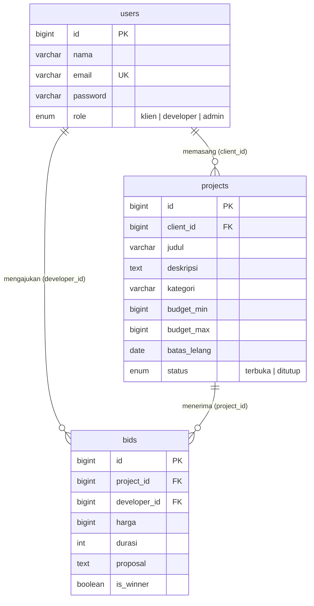

# Garuda-Hub (Laravel)

Website lelang proyek IT: klien memasang proyek, developer menawar, klien memilih pemenang.
Branch ini adalah hasil refactor prototype PHP native ke **Laravel 12** dengan arsitektur **MVC** dan **Eloquent ORM**.
Kode PHP native aslinya (`src/index.php`, `src/database.sql`, `prototype/`) masih ada di branch `main`.

> Hanya untuk komputer lokal atau lingkungan belajar. Semua data adalah data dummy; jangan memasukkan data pribadi atau password asli.

## Menjalankan di Laragon

Butuh PHP 8.2+, Composer, dan MySQL/MariaDB (bawaan Laragon).

```bat
composer install
copy .env.example .env
php artisan key:generate
mysql -u root -e "CREATE DATABASE garuda_hub_laravel"
php artisan migrate:fresh --seed
php artisan serve
```

Buka http://localhost:8000

| Peran | Email | Password |
| --- | --- | --- |
| Admin | admin@example.com | admin123 |
| Klien | budi@example.com | klien123 |
| Developer | dewi@example.com | dev123 |

Jalankan tes: `php artisan test`

## Struktur MVC

| Lapisan | Lokasi | Isi |
| --- | --- | --- |
| Model | `app/Models` | `User`, `Project`, `Bid` + relasi Eloquent |
| View | `resources/views` | Blade: layout, auth, projects, bids, dashboard, admin |
| Controller | `app/Http/Controllers` | `AuthController`, `ProjectController`, `BidController`, `DashboardController`, `AdminController` |
| Validasi | `app/Http/Requests` | `RegisterRequest`, `ProjectRequest`, `BidRequest` |
| Otorisasi | `app/Policies`, `app/Http/Middleware/EnsureRole.php` | siapa boleh edit/hapus/pilih pemenang; middleware `role:` |
| Rute | `routes/web.php` | dikelompokkan per peran |
| Skema | `database/migrations` | tabel `users`, `projects`, `bids` |
| Data dummy | `database/seeders/DatabaseSeeder.php` | data dari `src/database.sql` (branch `main`) |

## Skema database



Perbaikan dibanding prototype (`prototype/mocks/database.sql` di branch `main`):

- `users.email` **UNIQUE**; `role` dan `status` jadi **ENUM**, bukan VARCHAR bebas.
- **Foreign key** `projects.client_id → users`, `bids.project_id → projects`, `bids.developer_id → users`, semuanya `ON DELETE CASCADE` agar tidak ada data yatim.
- **UNIQUE (`project_id`, `developer_id`)**: satu developer hanya satu penawaran per proyek.
- **CHECK** `budget_max >= budget_min` dan `harga > 0 AND durasi > 0` (MySQL 8.0.16+ / MariaDB).
- Index pada `status`, `kategori`, `role`, dan kolom FK.

## CRUD (Eloquent)

| Entitas | Create | Read | Update | Delete |
| --- | --- | --- | --- | --- |
| Project (klien) | `$user->projects()->create()` | `Project::with('client')->withCount('bids')->search()` | `$project->update()` | `$project->delete()` |
| Bid (developer) | `$bid->project()->associate()->save()` | `$project->bids`, `$user->bids()` | `$bid->update()` | `$bid->delete()` |
| User (admin) | `$user->save()` saat daftar | `User::withCount()` | `forceFill(['role'])` | `$user->delete()` |

Memilih pemenang memakai `DB::transaction()` + `lockForUpdate()` supaya tidak ada dua pemenang.

## Lisensi

MIT. Lihat [LICENSE](LICENSE).
